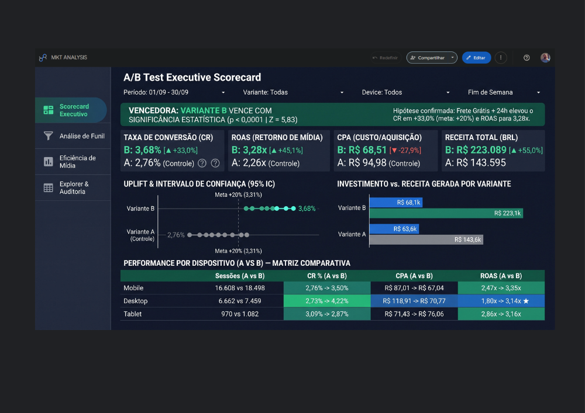
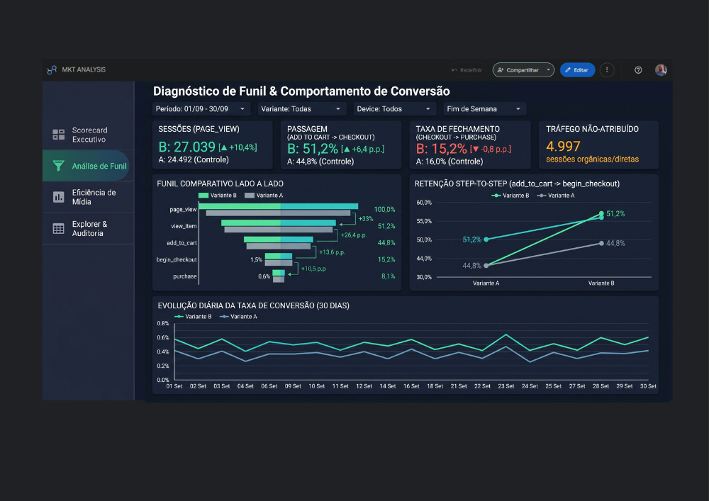
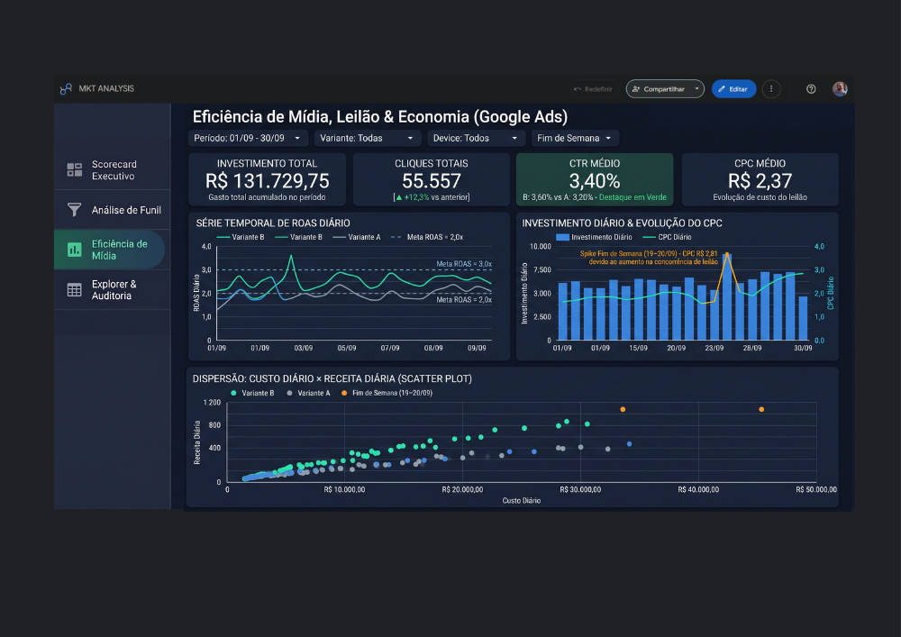

# Marketing Analytics & Teste A/B — ELT batch com dbt no Postgres


O projeto implementa um pipeline **ELT em batch** sobre uma **Arquitetura Medalhão (Landing → Raw → Staging → Marts → BI)** para avaliar o experimento de marketing **`EXP_2026_Q3_01`** (*Teste A/B de Proposta de Valor em Landing Page*, realizado de `01/09/2026` a `30/09/2026`), cruzando eventos de web do **GA4 (Google Analytics 4)**, relatório de mídia do **Google Ads** e os metadados do teste para alimentar um dashboard no **Looker Studio** que responde qual variante vence:

* **Variante A (Controle):** *"Control - 15% OFF Primeira Compra"* (Campanha `20491001`, prefixo `variant_a_desconto15`, LP `/oferta-especial-a`).
* **Variante B (Tratamento):** *"Treatment - Frete Grátis + Entrega 24h"* (Campanha `20491002`, prefixo `variant_b_frete24h`, LP `/oferta-especial-b`).

A ingestão é feita em **Python/pandas** (`src/seed.py`, lendo Parquet da camada
`data/landing/` → schema `raw` do Postgres). A partir daí, o **dbt Core** assume:
declara as fontes, cria a camada de **staging** (limpeza e padronização) e os
**marts** dimensionais (Star Schema), aplicando testes de integridade em cada
camada. O projeto roda no **homelab** (onpremises) e serve de estudo de boas práticas de
engenharia analítica.

> **Documentação e aprendizados:**
>
> * [catalogo-dados-mkt.md](catalogo-dados-mkt.md) — **catálogo e dicionário de dados**: esquemas, tipos, granularidade, linhagem, o mapa de anomalias propositais e a especificação do dashboard.
> * [insights-experimento-ab.md](insights-experimento-ab.md) — **insights de negócio e data storytelling**: as 5 descobertas estatísticas do experimento A/B.
> * [aprendizados.md](aprendizados.md) — decisões técnicas e o *porquê* de cada boa prática.

---

## Contexto do Projeto

**Problema:** Garantir dados limpos e padronizados, para avaliação de um teste A/B de marketing que exige cruzar três fontes que não
falam a mesma língua e que na maioria das vezes vem com dados sujos:

* **Custo em micros:** o `cost_micros` do Google Ads vem multiplicado por 1.000.000. Sem corrigir, o CPA e o ROAS saem distorcidos em um milhão de vezes.
* **UTMs despadronizadas:** ~4,5% dos eventos do GA4 têm espaços e maiúsculas (`"Google "`, `"CPC"`), o que quebra os `JOIN`s de atribuição com as campanhas de Ads.
* **Eventos duplicados:** ~0,9% dos eventos do GA4 repetem o mesmo `event_id` (F5 do usuário), superdimensionando tráfego e receita.
* **Bots e QA interno:** ~0,3% dos eventos são não-humanos e contaminam as taxas de conversão.

**Objetivo:** construir um pipeline ELT que:

* Carrega os 3 datasets brutos (Parquet) no schema `raw` do Postgres, preservando o dado original.
* **Declara as fontes** no dbt para habilitar linhagem, testes e `{{ source() }}`.
* Limpa e padroniza cada fonte na camada **staging** (`stg_*`): deduplicação, casts, correção de micros, normalização de UTMs, filtro de bots.
* Consolida o resultado em **marts** dimensionais (Star Schema) e mede a variante vencedora (conversão, CPA, ROAS, significância via Z-Test).
* Expõe a Gold ao **Looker Studio** para consumo visual.

**Resultado esperado:** modelos confiáveis e testados, mais um dashboard que responde qual
variante (A = controle, B = tratamento) teve melhor desempenho, com a sujeira
tratada na camada certa.

---

## Arquitetura Medalhão

Fluxo completo nas camadas **Landing → Raw → Staging → Marts → Dashboard**:

```text
Fontes de Marketing Digital
   • GA4 web events        (export de eventos em lote diário)
   • Google Ads ad report  (conector Fivetran, D-1)
   • Metadata do A/B       (cadastro do experimento)
            │
   Landing — Apache Parquet (data/landing/)
   • ga4_events/*.parquet
   • google_ads/*.parquet
   • ab_test_metadata/*.parquet
            │
   Ingestão — src/seed.py  (pandas + SQLAlchemy, Parquet → Postgres)
            │
   ┌──────────────── PostgreSQL (warehouse) ────────────────┐
   │  schema raw      → tabelas brutas carregadas as-is      │
   │  schema staging  → modelos stg_ (views, limpeza 1:1)    │
   │  schema marts    → modelos fct_/dim_ (tables, análise)  │
   └──────────────────────── dbt Core ──────────────────────┘
            │
   Dashboard — Looker Studio (conector Postgres, lê o schema marts)
   • Scorecard da variante vencedora  • Funil de drop-off  • Curva de ROAS
```

**Por que ELT e não ETL:** o dado bruto é carregado primeiro (Load) e só então
transformado (Transform) **dentro do banco**, com dbt. Isso mantém o raw auditável
e reprocessável, e concentra toda a lógica de transformação em SQL versionado.

### Camadas

| Camada | Onde vive | Papel |
| :--- | :--- | :--- |
| **Landing** | Parquet em `data/landing/` | Formato de intercâmbio: como o dado chega do conector, antes de ir ao banco. |
| **raw** (bronze) | schema `raw` (via `src/seed.py`) | Parquet carregado *as-is*, sem limpeza. Fonte de verdade auditável. |
| **staging** (silver) | `models/staging/` → views em `staging` | Limpeza 1:1 com a fonte: dedup, casts, correção de micros, UTMs. |
| **marts** (gold) | `models/marts/` → tables em `marts` | Modelos dimensionais finais (fatos e dimensões) para consumo. |
| **Dashboard** | Looker Studio | Camada de visualização e KPIs de negócio. |

---

## As três fontes (camada bronze)

| Tabela | Grão | Volume | Observação |
| :--- | :--- | :--- | :--- |
| `raw_ab_test_metadata` | 1 linha por variante (A/B) | 2 | Dá significado de negócio às campanhas. |
| `raw_google_ads_ad_report` | dia × campanha × ad_group × ad × device | 720 | `cost_micros` em micros (÷ 1e6 no staging). |
| `raw_ga4_events` | 1 por evento disparado | 97.278 | Sujeira proposital: 845 duplicatas, bots, UTMs despadronizadas. |

Detalhamento coluna a coluna e o catálogo de anomalias estão em
[catalogo-dados-mkt.md](catalogo-dados-mkt.md).

---

## O modelo dimensional (camada gold)

Star Schema com **2 dimensões** e **4 fatos**, já construído e em uso:

| Tabela | Tipo | Grão | Volume |
| :--- | :--- | :--- | :--- |
| `dim_variant` | Dimensão | 1 por variante A ou B | 2 |
| `dim_date` | Dimensão | 1 por dia | 30 |
| `fct_funil` | Fato | dia × variante × device × etapa | 906 |
| `fct_performance_diaria` | Fato | dia × variante × device | 180 |
| `fct_ad_gasto_diario` | Fato | dia × campanha × variante × device | 180 |
| `fct_ab_test_results` | Fato | 1 por variante (resumo + Z-Test) | 2 |

A `fct_ab_test_results` é a tabela-resposta do projeto: além de CR, CPA, ROAS e
ticket médio, carrega `z_stat` e `p_valor` do **Z-Test de proporções**, que diz
se a diferença entre A e B é estatisticamente significativa.

---

## Resultados e Insights do Experimento A/B

Detalhados em [insights-experimento-ab.md](insights-experimento-ab.md).

### Ficha Técnica do Teste A/B

| Item | Detalhe |
| :--- | :--- |
| **O que foi testado** | Se destacar "Frete Grátis + 24h" aumentaria a conversão em pelo menos +20% |
| **Métrica principal** | Taxa de conversão de compras (pedidos ÷ visitas) |
| **Método de validação** | Teste Z de proporções (com 95% de nível de confiança) |
| **Visitas mínimas necessárias** | ~15 mil por grupo (planejadas antes de iniciar o teste) |
| **Visitas reais coletadas** | 24,2 mil (Controle) vs. 27,0 mil (Tratamento) — amostra superou a meta |
| **Tempo de execução** | 30 dias completos (4 semanas cheias, sem parar o teste antes da hora) |
| **Resultado prático** | A conversão subiu de **2,76% para 3,68%** (**+33% de ganho real**) |
| **Margem de segurança** | Ganho real entre **+22% e +44%** (mesmo no pior cenário, bate a meta de +20%) |
| **Confiabilidade** | 99,9% de certeza estatística de que o resultado não foi sorte (*p < 0,0001*) |

**Principais conclusões:**

* **Veredito estatístico (`p < 0,0001`):** a **Variante B (Frete Grátis + Entrega 24h)** venceu em todas as métricas — elevou a conversão real de **2,76% para 3,68% (+33,0% de uplift)**, reduziu o CPA de **R$ 94,98 para R$ 68,51 (-27,9%)** e aumentou o ROAS de **2,26x para 3,28x (+45,1%)**.
* **Redução de fricção no carrinho:** o maior salto do funil ocorre na passagem `add_to_cart → begin_checkout` (**51,2% na B vs. 44,8% na A**), confirmando a hipótese de que o frete grátis reduz o abandono de carrinho.
* **Virada no Desktop e Mobile:** a Variante B recuperou a eficiência do Desktop (`ROAS` de `1,80x` para `3,14x` e `CR` de `2,73%` para `4,22%`) e escalou o Mobile (`ROAS` de `2,47x` para `3,35x`).
* **Anomalia de leilão mapeada:** o spike de CPC nos dias **19 e 20/09** (`+19%`, chegando a `R$ 2,81`) foi isolado como evento pontual daquele fim de semana, enquanto os demais fins de semana mantiveram `ROAS` médio de `2,99x`.

---

## 📊 Dashboards (Looker Studio)

Telas construídas sobre o Star Schema da camada `marts`. Os
visuais respondem à pergunta central do projeto — **qual variante vence e com
que confiança** — e abrem para a economia de mídia por trás do resultado.

### Scorecard Executivo & Análise A/B



Veredito do experimento em uma tela: a faixa de topo declara a **variante
vencedora com significância estatística** (`p < 0,0001`, `Z = 5,83`) e os
cartões trazem as métricas-chave lado a lado (CR, ROAS, CPA e receita total,
B vs. A). Abaixo, o gráfico de **uplift com intervalo de confiança de 95%**
contra a meta de +20%, o comparativo de **investimento vs. receita gerada** por
variante e a **matriz de performance por dispositivo** (Mobile, Desktop,
Tablet), destacando a virada de eficiência no Desktop.

### Diagnóstico de Funil & Comportamento de Conversão



Onde cada variante ganha ou perde o usuário ao longo do funil
(`page_view → view_item → add_to_cart → begin_checkout → purchase`). Os cartões
destacam **sessões, passagem `add_to_cart → checkout`, taxa de fechamento e
tráfego não-atribuído**; o **funil comparativo lado a lado** e o gráfico de
**retenção step-to-step** evidenciam o maior salto da Variante B na passagem
`add_to_cart → begin_checkout` (**51,2% vs. 44,8%**), e a **evolução diária da
taxa de conversão** mostra a B acima da A ao longo dos 30 dias — confirmando que
o frete grátis reduz o abandono de carrinho.

### Eficiência de Mídia, Leilão & Economia (Google Ads)



Leitura da mídia paga sob a ótica de custo e retorno: cartões de **investimento
total, cliques, CTR e CPC médio**, a **série temporal de ROAS diário** por
variante (contra as metas de 2,0x e 3,0x), a **evolução do CPC diário** com o
*spike* de leilão isolado em **19–20/09** e o **scatter de custo × receita
diária**, que mostra a Variante B consistentemente acima da reta de eficiência.

> A especificação completa das abas (KPIs, dimensões e memória de cálculo) está
> em [catalogo-dados-mkt.md](catalogo-dados-mkt.md).

---

## Tecnologias Utilizadas

| Ferramenta | Uso |
| :--- | :--- |
| **Python 3.12** | Linguagem da ingestão. |
| **pandas** | Leitura dos Parquet de `data/landing/` e escrita no Postgres. |
| **SQLAlchemy + psycopg** | Conexão e engine com o PostgreSQL. |
| **Apache Parquet** | Formato colunar da camada landing. |
| **PostgreSQL** | Data warehouse (schemas `raw`, `staging`, `marts`). |
| **dbt Core + dbt-postgres** | Transformação, testes, sources e linhagem. |
| **Looker Studio** | Dashboard de consumo (conector Postgres). |
| **python-dotenv** | Carregar credenciais do `.env` (fora do Git). |
| **uv** | Gerenciamento de ambiente e dependências. |
| **Markdown / Mermaid** | Documentação como código (catálogo e diagramas). |

---

## Estrutura do Projeto

```text
dbt-abtest-marketing-analytics/
├── .env.example                   # Molde das variáveis (sem segredos) — versionado
├── .gitignore                     # segredos e guias de contexto
├── pyproject.toml                 # Dependências do projeto (uv)
├── uv.lock
├── README.md                      # Este arquivo
├── aprendizados.md                # Decisões técnicas e lições aprendidas
├── catalogo-dados-mkt.md          # Catálogo e dicionário de dados
├── insights-experimento-ab.md     # Insights de negócio e data storytelling do A/B
│
├── src/
│   └── seed.py                    # Ingestão: Parquet (data/landing) → schema raw
│
├── sql/
│   ├── grant_looker_ro.sql        # Role somente-leitura do BI (schema marts)
│   └── looker_queries.sql         # Queries de consumo (Custom Query no Looker)
│
├── assets/                        # Telas do dashboard (PNG)
│   ├── dash1mkt.png               # Scorecard Executivo & Análise A/B
│   ├── dash2mkt.png               # Diagnóstico de Funil & Comportamento de Conversão
│   └── dash3mkt.png               # Eficiência de Mídia, Leilão & Economia
│
├── data/
│   └── landing/                   # Dados brutos em Parquet — IGNORADO (fora do Git)
│       ├── ab_test_metadata/raw_ab_test_metadata.parquet
│       ├── ga4_events/raw_ga4_events.parquet
│       └── google_ads/raw_google_ads_ad_report.parquet
│                                  # (+ *.parquet.example versionados — ver nota abaixo)
│
└── marketing_analytics/           # Projeto dbt
    ├── dbt_project.yml            # Config: staging=view, marts=table
    ├── macros/
    │   ├── get_custom_schema.sql  # Override do schema para nomes limpos
    │   └── to_money.sql           # Conversão de custo/receita para numeric
    ├── models/
    │   ├── staging/
    │   │   ├── _sources.yml       # Declaração das 3 fontes (raw)
    │   │   ├── stg_ab_test_metadata.sql
    │   │   ├── stg_ga4_events.sql
    │   │   └── stg_google_ads_ad_report.sql
    │   └── marts/
    │       ├── _models.yml
    │       ├── dim_date.sql
    │       ├── dim_variant.sql
    │       ├── fct_ab_test_results.sql
    │       ├── fct_ad_gasto_diario.sql
    │       ├── fct_funil.sql
    │       └── fct_performance_diaria.sql
    └── tests/                     # Testes singulares 
```

> Os arquivos `*.parquet.example` em `data/landing/` são **amostras controladas
> e versionadas**, para que o pipeline possa ser testado sem o dado real


---

## Como Reproduzir

### Pré-requisitos

* Python 3.12 e [uv](https://docs.astral.sh/uv/) instalados.
* Um PostgreSQL acessível (local ou no homelab).
* Os Parquets brutos em `data/landing/` — ou os `*.parquet.example` versionados, que já permitem rodar o pipeline de ponta a ponta sem o dado real (ver catálogo de dados).

### 1. Instalar as dependências

```bash
uv sync
```

### 2. Configurar o `.env`

Copie o molde versionado e preencha com suas credenciais:

```bash
cp .env.example .env
```

Depois edite o `.env` com os valores reais:

```env
DB_HOST=localhost
DB_PORT=5430
DB_USER=seu_usuario
DB_PASSWORD=sua_senha
DB_NAME=mkt_ads
LOGIN_LOOKER=senha_do_looker_ro      # opcional, só para a conexão do BI
NGROK_AUTHTOKEN=seu_authtoken_ngrok  # opcional, só para expor o Postgres ao Looker
```

> O `.env` está no `.gitignore` e **não deve ser versionado** — ele contém
> segredos. O repositório traz apenas o `.env.example` (sem valores reais) como
> referência das variáveis necessárias.

### 3. Carregar os dados brutos (ingestão)

```bash
uv run python src/seed.py
```

Isso cria o schema `raw` (se não existir) e carrega as 3 tabelas brutas no Postgres.

### 4. Rodar as transformações com dbt

```bash
cd marketing_analytics

dbt debug      # valida a conexão com o Postgres (profile)
dbt deps       # instala pacotes dbt, se houver
dbt build      # roda os modelos + testes (staging → marts)
```

> `dbt build` executa os modelos na ordem do DAG e roda os testes declarados
> (ex.: `unique`/`not_null` nas sources, e os testes singulares anti-fan-out) na
> mesma passada.

---

## Conectar o Dashboard (Looker Studio)

O Looker Studio é um serviço na nuvem do Google e precisa alcançar o Postgres por
um `host:porta` público. O caminho adotado — **ngrok** para validar e **Postgres
gerenciado** (Neon/Supabase) para o permanente — em resumo:

1. Criar um role **somente-leitura** restrito ao schema `marts`
   (`sql/grant_looker_ro.sql`) — o BI nunca usa o dono do banco.
2. Expor a porta do Postgres temporariamente (`ngrok tcp 5430`) para validar.
3. No Looker, conector **PostgreSQL** → **Custom Query** qualificando o schema
   (`SELECT * FROM marts.<tabela>`), pois o conector lista o schema `public`
   (vazio) por padrão. As queries prontas estão em `sql/looker_queries.sql`.

---

## Lições Aprendidas

Detalhadas em [aprendizados.md](aprendizados.md). Em resumo:

* **ELT com dbt:** carregar o bruto primeiro e transformar dentro do banco mantém o raw auditável e a lógica versionada em SQL.
* **Sources desacoplam o físico do uso:** `{{ source('raw', ...) }}` habilita linhagem, testes e *freshness* sem fixar o nome da tabela nos modelos.
* **Testar a regra certa na camada certa:** `event_id` só é `unique` **depois** da deduplicação no staging — por isso o teste de unicidade não fica na fonte.
* **Dinheiro nunca em `float`:** `cost_micros` (÷1e6) e `purchase_revenue_brl` convergem para `numeric` no staging — ponto fixo, exato.
* **Convenção `stg_`:** o nome do modelo comunica a camada e o papel, deixando o DAG legível e o projeto no padrão de mercado.
* **Conectar o BI é arquitetura, não só SQL:** `host:porta` alcançável, role somente-leitura, schema de busca e grão das fontes (anti-fan-out) ao preparar as queries do Looker.

---

## Próximos Passos

* [x]  Modelos `stg_` completos para as 3 fontes (dedup, casts, micros, UTMs, filtro de bots).
* [x]  Marts dimensionais: funil, performance diária, gasto de mídia e resultado do A/B (CPA, ROAS, Z-Test).
* [x]  Testes singulares anti-fan-out e de grão único no `marts`.
* [x]  Conexão do Looker Studio à Gold (role somente-leitura + Custom Query).
* [x]  Telas do dashboard (Scorecard A/B, Funil e Eficiência de Mídia) — ver seção **Dashboards**.
* [ ]  Publicar o dashboard final no Looker Studio (scorecard, funil, ROAS no tempo, auditoria).
