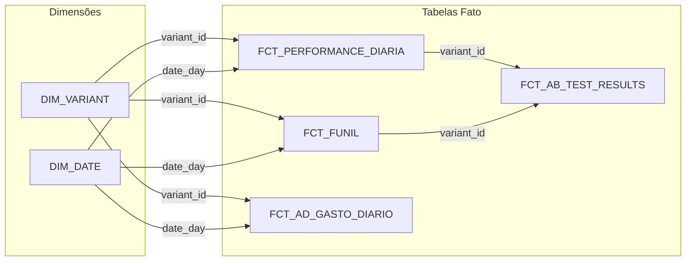

# Catálogo e Dicionário de Dados - Marketing Analytics & Teste A/B

Este documento é a referência oficial da modelagem e arquitetura de dados do projeto de **Marketing Analytics & Teste A/B**, detalhando os esquemas, tipos de dados, regras de negócio, linhagem e a especificação completa do pipeline, abrangendo as camadas **Landing**, **Raw**, **Staging**, **Gold (Marts)** e o **Dashboard**.

---

## Glossário de Termos e Siglas (Dados de Mídia & Web Analytics)

* **GCLID (*Google Click Identifier*):** Identificador alfanumérico exclusivo anexado à URL pelo Google Ads no momento do clique, utilizado para reconciliar o clique do anúncio com a sessão do GA4.
* **UTM (*Urchin Tracking Module*):** Parâmetros de rastreamento padronizados inseridos nas URLs (`utm_source`, `utm_medium`, `utm_campaign`, `utm_content`) para atribuir sessões às respectivas campanhas e anúncios.
* **Micros de Custo (`cost_micros`):** Unidade monetária inteira padrão da Google Ads API e de conectores Fivetran/Airbyte, onde o valor financeiro é multiplicado por $1.000.000$ ($1{,}00\text{ BRL} = 1.000.000\text{ micros}$).
* **CTR (*Click-Through Rate*):** Taxa de clique do anúncio ($\text{Cliques} / \text{Impressões}$).
* **CPC (*Cost Per Click*):** Custo médio pago por clique realizado no anúncio.
* **CPA (*Cost Per Acquisition*):** Custo por aquisição/venda ($\text{Investimento Total} / \text{Conversões}$).
* **ROAS (*Return On Ad Spend*):** Retorno financeiro sobre o investimento em mídia ($\text{Receita} / \text{Investimento}$).
* **CR (*Conversion Rate*):** Taxa de conversão ($\text{Conversões} / \text{Sessões}$).
* **AOV (*Average Order Value*):** Ticket médio ($\text{Receita} / \text{Conversões}$).
* **Client ID / `user_pseudo_id`:** Identificador anônimo único gerado pelo cookie `_ga` para distinguir visitantes únicos em diferentes visitas.
* **Session ID / `ga_session_id`:** Timestamp Unix que identifica uma sessão contínua de navegação de um usuário.
* **Z-Test de Proporções:** Teste estatístico que compara duas taxas de conversão (A vs. B) e informa se a diferença é significativa ou ruído.
* **Variante A (Controle):** Versão de referência atual do anúncio/landing page (*"15% OFF na Primeira Compra"*).
* **Variante B (Tratamento):** Nova hipótese testada (*"Frete Grátis + Entrega em 24h"*).

---

## Camadas do Pipeline

O dado percorre cinco paradas, nesta ordem:

| Camada | Onde vive | Papel | Tipo no dicionário |
| :--- | :--- | :--- | :--- |
| **Landing** | arquivos Parquet em `data/landing/` | Como o dado **chega** do conector (formato de intercâmbio). | `Landing (Parquet)` |
| **Raw** | schema `raw` no Postgres (via `src/seed.py`) | Como o dado foi **salvo no banco**, as-is. | `Raw (DB)` |
| **Staging** | schema `staging` no Postgres (views dbt) | Como o dado ficou após **limpeza, casts e padronização**. | `Staging` |
| **Gold / Marts** | schema `marts` no Postgres (tables dbt) | Modelos analíticos finais (fatos e dimensões). | `Marts (DB)` |
| **Dashboard** | Looker Studio (conector Postgres) | Camada de visualização e KPIs de negócio. | — |

> O dicionário coluna a coluna das tabelas da Parte 1 traz três colunas de tipo — **Landing (Parquet)**, **Raw (DB)** e **Staging** — para tornar explícita a transformação de tipo em cada parada do dado.

---

## Arquitetura Geral do Pipeline

> [!NOTE]
> O diagrama abaixo está dividido em **duas linhas (fases)** para visualização otimizada em monitores verticais e telas responsivas.

```mermaid
flowchart TD
    subgraph ROW1["FASE 1: INGESTÃO & DATA LAKE (Origem → Landing Raw)"]
        direction LR
        S1["1. Origens de Dados<br/>• Google Ads API (Fivetran)<br/>• GA4 Web Events"]
        S2["2. Data Lake local (data/landing/)<br/>• google_ads/*.parquet<br/>• ga4_events/*.parquet<br/>• ab_test_metadata/*.parquet"]
        S1 -->|Extração Diária| S2
    end

    subgraph ROW2["FASE 2: WAREHOUSE & ANALYTICS (Transformação → BI)"]
        direction LR
        S3["3. PostgreSQL & dbt Core<br/>• raw (carga via src/seed.py)<br/>• staging (Limpeza, Casts, Dedup)<br/>• marts (Z-Test, CPA, ROAS)"]
        S4["4. Looker Studio Dashboard<br/>• Scorecard da Variante Vencedora<br/>• Funil de Drop-off & Curva de ROAS"]
        S3 -->|Modelos Fato| S4
    end

    ROW1 ==>|Carga para o schema raw (Postgres)| ROW2

    %% Estilos de Alto Contraste (Sem azul/lilás desbotado)
    style ROW1 fill:#FDF4E3,stroke:#B45309,stroke-width:2px,color:#78350F
    style ROW2 fill:#F1F5F9,stroke:#334155,stroke-width:2px,color:#0F172A

    style S1 fill:#9A3412,stroke:#EA580C,stroke-width:2px,color:#FFFFFF
    style S2 fill:#334155,stroke:#64748B,stroke-width:2px,color:#FFFFFF
    style S3 fill:#1E293B,stroke:#64748B,stroke-width:2px,color:#FFFFFF
    style S4 fill:#854D0E,stroke:#CA8A04,stroke-width:2px,color:#FFFFFF
```

---

# PARTE 1: CAMADAS LANDING E RAW (Dados Brutos)

## Informações Gerais das Camadas Landing e Raw
* **Formato de Armazenamento (Landing):** Apache Parquet (armazenamento colunar comprimido). É o único formato na landing — não há espelhamento em CSV.
* **Destino (Raw):** schema `raw` no PostgreSQL, carregado por `src/seed.py` (pandas + `COPY`).
* **Frequência de Extração:** Diária (D-1 para relatórios de mídia agregada do Google Ads; export de eventos do GA4 em lote diário).
* **Padrão de Nomenclatura e Localização dos Arquivos:**
  * `data/landing/ab_test_metadata/raw_ab_test_metadata.parquet`
  * `data/landing/google_ads/raw_google_ads_ad_report.parquet`
  * `data/landing/ga4_events/raw_ga4_events.parquet`
* **Metadados de Linhagem (Audit Columns):**
  * `_fivetran_synced` (`large_string` / `text`): Timestamp UTC da extração da API do Google Ads pelo conector Fivetran. Presente na landing e na raw do Google Ads.
  * `_ingested_at` (`large_string` / `text`): Timestamp UTC de gravação do lote de eventos do GA4. Presente na landing e na raw do GA4.
  * `_loaded_at` (`timestamptz`): Timestamp UTC da carga no Postgres, injetado por `src/seed.py`. Só na camada **raw** (as três tabelas).
  * `_source_file` (`text`): Nome do arquivo Parquet de origem, injetado por `src/seed.py`. Só na camada **raw** (as três tabelas).

---

### Diagrama de Relacionamento das Tabelas Brutas (Raw ERD)

```mermaid
erDiagram
    RAW_AB_TEST_METADATA ||--o{ RAW_GOOGLE_ADS_AD_REPORT : "campaign_id"
    RAW_GOOGLE_ADS_AD_REPORT ||--o{ RAW_GA4_EVENTS : "utm_campaign / utm_content"

    RAW_AB_TEST_METADATA {
        string test_id PK
        string variant_id PK
        string test_name
        string variant_label
        string campaign_id FK
        string campaign_name
        string utm_campaign
        string utm_content_prefix
        string landing_page_path
        string hypothesis
        string start_date
        string end_date
        boolean is_control
        timestamptz _loaded_at
        string _source_file
    }

    RAW_GOOGLE_ADS_AD_REPORT {
        string date_day PK
        string account_id
        string campaign_id FK "tambem compoe a PK natural"
        string campaign_name
        string campaign_status
        string ad_group_id PK
        string ad_group_name
        string ad_id PK
        string ad_name
        string ad_type
        string device PK
        string final_url
        string utm_source
        string utm_medium
        string utm_campaign
        string utm_content
        int64 impressions
        int64 clicks
        int64 cost_micros
        string _fivetran_synced
        timestamptz _loaded_at
        string _source_file
    }

    RAW_GA4_EVENTS {
        string event_date
        int64 event_timestamp
        string event_id PK
        string event_name
        string user_pseudo_id
        int64 ga_session_id
        string device_category
        string operating_system
        string geo_country
        string geo_region
        string page_location
        string traffic_source_source
        string traffic_source_medium
        string traffic_source_name
        string utm_content
        string gclid
        int64 engagement_time_msec
        float64 purchase_revenue_brl
        string transaction_id
        string event_params_json
        string _ingested_at
        timestamptz _loaded_at
        string _source_file
    }
```



---

### 1.1 Tabela: `raw_ab_test_metadata`
* **Descrição:** Cadastro mestre do experimento de Teste A/B, parametrizando as variantes, campanhas vinculadas, hipóteses de negócio e janela de execução.
* **Granularidade:** Uma linha por variante do experimento (`A` ou `B`).
* **Volume:** 2 registros.
* **Modelo staging:** `stg_ab_test_metadata`.

| Coluna | Landing (Parquet) | Raw (DB) | Staging | Nulo? | Chave | Descrição | Exemplo / Regras |
| :--- | :--- | :--- | :--- | :--- | :--- | :--- | :--- |
| `test_id` | `large_string` | `text` | `text` | Não | **PK** | Identificador único do experimento A/B | `"EXP_2026_Q3_01"` |
| `test_name` | `large_string` | `text` | `text` | Não | — | Nome funcional do experimento | `"ab_test_lp_value_proposition"` |
| `variant_id` | `large_string` | `text` | `text` | Não | **PK** | Código da variante testada (`A` = Controle, `B` = Tratamento) | `"A"`, `"B"` |
| `variant_label` | `large_string` | `text` | `text` | Não | — | Descrição da proposta de valor veiculada | `"Control - 15% OFF Primeira Compra"` |
| `campaign_id` | `large_string` | `text` | `text` | Não | **FK** | ID da campanha no Google Ads vinculada à variante | `"20491001"`, `"20491002"` |
| `campaign_name` | `large_string` | `text` | `text` | Não | — | Nome oficial da campanha no Google Ads | `"gads_search_ab_control_desconto15"` |
| `utm_campaign` | `large_string` | `text` | `text` | Não | — | Nome da campanha configurado nas tags de URL | `"search_ab_promo_q3"` |
| `utm_content_prefix` | `large_string` | `text` | `text` | Não | — | Prefixo dos anúncios associados à variante | `"variant_a_desconto15"`, `"variant_b_frete24h"` |
| `landing_page_path` | `large_string` | `text` | `text` | Não | — | Caminho relativo da página de destino testada | `"/oferta-especial-a"`, `"/oferta-especial-b"` |
| `hypothesis` | `large_string` | `text` | `text` | Não | — | Hipótese formal documentada para o teste | `"Destacar Frete Grátis + Entrega 24h eleva CR em +20%"` |
| `start_date` | `large_string` | `text` | `date` | Não | — | Data oficial de início do experimento. **Cast `text → date` no staging.** | `"2026-09-01"` |
| `end_date` | `large_string` | `text` | `date` | Não | — | Data oficial de encerramento do experimento. **Cast `text → date` no staging.** | `"2026-09-30"` |
| `is_control` | `bool` | `boolean` | `boolean` | Não | — | Flag indicando se é o grupo de controle | `True` (Variante A), `False` (Variante B) |
| `_loaded_at` | — | `timestamptz` | `timestamptz` | Não | — | Auditoria: timestamp UTC da carga no raw (`src/seed.py`). | `2026-10-25 23:25:50+00` |
| `_source_file` | — | `text` | `text` | Não | — | Auditoria: nome do arquivo de origem. | `"raw_ab_test_metadata.parquet"` |

---

### 1.2 Tabela: `raw_google_ads_ad_report`
* **Descrição:** Relatório diário de performance e gasto por criativo e dispositivo, extraído no schema oficial do conector Fivetran Google Ads (`google_ads__ad_report`).
* **Granularidade:** Uma linha por `date_day` + `campaign_id` + `ad_group_id` + `ad_id` + `device`.
* **Volume:** 720 registros (30 dias $\times$ 2 campanhas $\times$ 2 grupos de anúncios $\times$ 2 anúncios $\times$ 3 dispositivos).
* **Modelo staging:** `stg_google_ads_ad_report`.

| Coluna (Raw) | Landing (Parquet) | Raw (DB) | Staging | Coluna no Staging | Nulo? | Chave | Descrição | Exemplo / Regras |
| :--- | :--- | :--- | :--- | :--- | :--- | :--- | :--- | :--- |
| — | — | — | `text` | `ad_report_sk` | Não | **PK (surrogate)** | Chave sintética: `md5` de date_day+campaign_id+ad_group_id+ad_id+device. Criada no staging. | `"a1b2c3..."` |
| `date_day` | `large_string` | `text` | `date` | `date_day` | Não | **PK (natural)** | Data de veiculação (`YYYY-MM-DD`). **Cast `text → date`.** | `"2026-09-01"` |
| `account_id` | `large_string` | `text` | `text` | `account_id` | Não | — | ID da conta de anúncios no Google Ads | `"849-201-4410"` |
| `campaign_id` | `large_string` | `text` | `text` | `campaign_id` | Não | **PK / FK** | Identificador da campanha | `"20491001"`, `"20491002"` |
| `campaign_name` | `large_string` | `text` | `text` | `campaign_name` | Não | — | Nome da campanha. **`trim`.** | `"gads_search_ab_control_desconto15"` |
| `campaign_status` | `large_string` | `text` | `text` | `campaign_status` | Não | — | Status de veiculação. **`lower+trim`.** | `"enabled"` |
| `ad_group_id` | `large_string` | `text` | `text` | `ad_group_id` | Não | **PK** | Identificador do grupo de anúncios | `"00101"`, `"00102"` |
| `ad_group_name` | `large_string` | `text` | `text` | `ad_group_name` | Não | — | Nome do grupo de anúncios. **`trim`.** | `"ag_high_intent_brand_terms"` |
| `ad_id` | `large_string` | `text` | `text` | `ad_id` | Não | **PK** | Identificador único do anúncio/criativo | `"00101101"` |
| `ad_name` | `large_string` | `text` | `text` | `ad_name` | Não | — | Nome do criativo. **`trim`.** | `"rsa_headline_urgency_v1"` |
| `ad_type` | `large_string` | `text` | `text` | `ad_type` | Não | — | Tipo de formato de anúncio. **`lower+trim`.** | `"responsive_search_ad"` |
| `device` | `large_string` | `text` | `text` | `device` | Não | **PK** | Categoria de dispositivo. **`lower+trim`.** | `"mobile"`, `"desktop"`, `"tablet"` |
| `final_url` | `large_string` | `text` | `text` | `final_url` | Não | — | URL final de destino com UTM/tracking. **`trim`.** | `"https://loja.exemplo.com.br/oferta-especial-a?utm_..."` |
| `utm_source` | `large_string` | `text` | `text` | `utm_source` | Não | — | Origem de mídia. **`lower+trim`.** | `"google"` |
| `utm_medium` | `large_string` | `text` | `text` | `utm_medium` | Não | — | Canal de mídia. **`lower+trim`.** | `"cpc"` |
| `utm_campaign` | `large_string` | `text` | `text` | `utm_campaign` | Não | — | Campanha nas tags da URL. **`lower+trim`.** | `"search_ab_promo_q3"` |
| `utm_content` | `large_string` | `text` | `text` | `utm_content` | Não | — | Criativo nas tags da URL. **`lower+trim`.** | `"variant_a_desconto15_ag_high_in_101"` |
| `impressions` | `int64` | `bigint` | `bigint` | `impressoes` | Não | — | Volume de impressões. **Renomeada.** | `6524` |
| `clicks` | `int64` | `bigint` | `bigint` | `cliques` | Não | — | Volume de cliques. **Renomeada.** | `242` |
| `cost_micros` | `int64` | `bigint` | `numeric(18,2)` | `custo_brl` | Não | — | Custo em micros ($10^6$) na origem. **Dividido por 1e6 e renomeado p/ `custo_brl` (macro `to_money`).** | `515570000` → `515.57` |
| `_fivetran_synced` | `large_string` | `text` | — | — | Não | — | Timestamp UTC de sincronização do Fivetran. Não propagado ao staging. | `"2026-10-01T06:00:00+00:00"` |
| `_loaded_at` | — | `timestamptz` | — | — | Não | — | Auditoria da carga (`src/seed.py`). Só na raw. | `2026-10-25 23:25:51+00` |
| `_source_file` | — | `text` | — | — | Não | — | Nome do arquivo de origem. Só na raw. | `"raw_google_ads_ad_report.parquet"` |
| — | — | — | `timestamptz` | `data_processamento` | Não | — | Audit column do staging: `current_timestamp` do processamento. | `2026-10-25 23:49:07+00` |

---

### 1.3 Tabela: `raw_ga4_events`
* **Descrição:** Log de telemetria e eventos comportamentais/transacionais disparados pelos usuários no site (Padrão Export Nativo do GA4 para BigQuery).
* **Granularidade:** Uma linha por evento disparado no navegador do usuário.
* **Volume:** 97.278 registros brutos (raw). No staging, após dedup e filtro de bots/QA, o volume é menor.
* **Modelo staging:** `stg_ga4_events`. Aplica: dedup por `event_id` (mantém o menor `event_timestamp`), filtro de bots/QA, casts, `lower+trim` e colunas derivadas (`uf`, `engagement_time_sec`).

| Coluna (Raw) | Landing (Parquet) | Raw (DB) | Staging | Coluna no Staging | Nulo? | Chave | Descrição | Exemplo / Regras |
| :--- | :--- | :--- | :--- | :--- | :--- | :--- | :--- | :--- |
| `event_date` | `large_string` | `text` | `date` | `event_date` | Não | — | Data do evento (`YYYYMMDD` na origem). **`to_date(...,'YYYYMMDD')`.** | `"20260901"` → `2026-09-01` |
| `event_timestamp` | `int64` | `bigint` | `timestamptz` | `event_timestamp` | Não | — | Timestamp em micros Unix. **`to_timestamp(.../1e6)`.** | `1788268639000000` |
| `event_id` | `large_string` | `text` | `text` | `event_id` | Não | **PK (pós-dedup)** | UUID do disparo. Único **só no staging** (raw tem 845 duplicatas). | `"b17cf52c-91d3-..."` |
| `event_name` | `large_string` | `text` | `text` | `event_name` | Não | — | Nome do evento no funil | `"page_view"`, `"purchase"` |
| `user_pseudo_id` | `large_string` | `text` | `text` | `user_pseudo_id` | Não | — | Cookie do visitante (`client_id`). **Usado no filtro de bots.** | `"865933287.1788220800"` |
| `ga_session_id` | `int64` | `bigint` | `bigint` | `ga_session_id` | Não | — | Identificador da sessão | `1788275592` |
| `device_category` | `large_string` | `text` | `text` | `device_category` | Não | — | Dispositivo. Sem transformação. | `"mobile"`, `"desktop"` |
| `operating_system` | `large_string` | `text` | `text` | `operating_system` | Não | — | SO do dispositivo. **`lower+trim`.** | `"ios"`, `"android"` |
| `geo_country` | `large_string` | `text` | `text` | `geo_country` | Não | — | País. Sem transformação. | `"Brazil"` |
| `geo_region` | `large_string` | `text` | `text` | `geo_region` | Não | — | Estado por extenso. **`lower+trim`.** | `"sao paulo"` |
| — | — | — | `text` | `uf` | Sim | — | **Coluna nova:** sigla da UF derivada de `geo_region`. | `"SP"`, `"RJ"` |
| `page_location` | `large_string` | `text` | `text` | `page_location` | Não | — | URL completa com UTM/GCLID. Sem transformação. | `"https://loja.exemplo.com.br/oferta-a?utm_..."` |
| `traffic_source_source` | `large_string` | `text` | `text` | `traffic_source_source` | Sim | — | Origem de tráfego. **`lower+trim`** (origem tem `"Google "`). **Usada no filtro de QA.** | `"google"` |
| `traffic_source_medium` | `large_string` | `text` | `text` | `traffic_source_medium` | Sim | — | Meio de tráfego. **`lower+trim`.** | `"cpc"`, `"organic"` |
| `traffic_source_name` | `large_string` | `text` | `text` | `traffic_source_name` | Sim | — | Nome da campanha (`utm_campaign`). **`lower+trim`.** | `"search_ab_promo_q3"` |
| `utm_content` | `large_string` | `text` | `text` | `utm_content` | Sim | — | Rótulo do anúncio. **`lower+trim`.** | `"variant_a_desconto15_ag_high_in_101"` |
| `gclid` | `large_string` | `text` | `text` | `gclid` | Sim | — | Token do clique do Google Ads. Sem transformação. | `"CjwKCAjw_81f3bb..."` |
| `engagement_time_msec` | `int64` | `bigint` | `bigint` | `engagement_time_msec` | Não | — | Tempo de tela ativa (ms). Original, mantido. | `15000` |
| — | — | — | `numeric` | `engagement_time_sec` | Não | — | **Coluna nova:** engajamento em segundos (`/1000.0`). | `15.0` |
| `purchase_revenue_brl` | `double` | `double precision` | `numeric(18,2)` | `purchase_revenue_brl` | Sim | — | Valor da compra (R\$). **`double → numeric(18,2)` (macro `to_money`).** Só em `purchase`. | `158.47` |
| `transaction_id` | `large_string` | `text` | `text` | `transaction_id` | Sim | — | Código do pedido. Só em `purchase`. Sem transformação. | `"TX-20260901-7D96DC12"` |
| `event_params_json` | `large_string` | `text` | `text` | `event_params_json` | Não | — | Parâmetros aninhados do GA4 (JSON como texto). | `'{"currency": "BRL", ...}'` |
| `_ingested_at` | `large_string` | `text` | `text` | `_ingested_at` | Não | — | Timestamp UTC de ingestão no lake (origem GA4). Propagado ao staging. | `"2026-10-01T06:15:00+00:00"` |
| `_loaded_at` | — | `timestamptz` | — | — | Não | — | Auditoria da carga (`src/seed.py`). Só na raw. | `2026-10-25 23:25:50+00` |
| `_source_file` | — | `text` | — | — | Não | — | Nome do arquivo de origem. Só na raw. | `"raw_ga4_events.parquet"` |
| — | — | — | `timestamptz` | `data_processamento` | Não | — | Audit column do staging: `current_timestamp` do processamento. | `2026-10-25 23:49:07+00` |

---

### 1.4  Sujeiras Reais Presentes nos Dados Brutos

limpezas e padronização realizada:

| Anomalia | Tabela Afetada | Volume Afetado | Manifestação no Dado Bruto | Impacto se não tratada |
| :--- | :--- | :---: | :--- | :--- |
| **Custo em Micros** | `raw_google_ads_ad_report` | 720 linhas (100%) | `cost_micros` com valores inteiros multiplicados por $1.000.000$ (ex: `515570000`) | Distorce o cálculo de investimento total, CPA e ROAS em um milhão de vezes. |
| **UTMs Despadronizadas** | `raw_ga4_events` | 4.333 eventos (~4,5%) | Valores com espaços e letras maiúsculas: `"Google "`, `"CPC"`, `"  VARIANT_B_..."` | Falha nos `JOINs` de atribuição com as tabelas de campanhas de Ads. |
| **Eventos Duplicados** | `raw_ga4_events` | 845 eventos (~0,9%) | Registros com o mesmo `event_id` disparados com 0.5s de diferença (F5 de usuário) | Superdimensionamento de métricas de tráfego e receita de compras (`purchase`). |
| **Tráfego de Bots e QA Interno** | `raw_ga4_events` | 304 eventos (~0,3%) | `user_pseudo_id LIKE 'bot_crawler_%'` e `traffic_source_source = 'internal_qa'` | Contaminação das taxas de conversão por acessos não-humanos. |

---

# PARTE 2: CAMADA STAGING (Silver - Limpeza e Padronização)

## Informações Gerais da Camada Staging
* **Onde vive:** schema `staging` no PostgreSQL.
* **Materialização:** `view` (barato, sempre fresco — recalcula a cada consulta; configurado em `dbt_project.yml`).
* **Papel:** uma view por fonte raw. Limpeza, casts, padronização de texto (`lower+trim`), deduplicação, filtro de lixo técnico e derivação de colunas. **Sem regra de negócio** (isso é a Gold).
* **Audit column padrão:** `data_processamento` (`timestamptz`) — `current_timestamp` do momento em que a linha passou pela view.
* **Dicionário coluna a coluna:** já detalhado na Parte 1 (coluna "Staging" e "Coluna no Staging" de cada tabela). Esta parte descreve a **regra de construção** de cada view.

---

### 2.1 View Staging: `stg_ab_test_metadata`
* **Descrição:** Dimensão de variante/experimento limpa, pronta para virar `dim_variant` na Gold.
* **Granularidade:** Uma linha por variante (`A`/`B`). Volume: 2.
* **Origem:** `raw.raw_ab_test_metadata`.
* **Regra de Construção:**
  1. Cast `start_date` e `end_date` de `text` para `date`.
  2. Cast `campaign_id` para `text` (identificador é rótulo, não número).
  3. Demais colunas passam direto (incluindo as audit columns `_loaded_at` e `_source_file`).

### 2.2 View Staging: `stg_google_ads_ad_report`
* **Descrição:** Fato de mídia limpo (gasto, cliques, impressões), base dos marts `fct_ad_gasto_diario` e `fct_performance_diaria`.
* **Granularidade:** Uma linha por `date_day` + `campaign_id` + `ad_group_id` + `ad_id` + `device`. Volume: 720.
* **Origem:** `raw.raw_google_ads_ad_report`.
* **Regra de Construção:**
  1. Cria a **surrogate key** `ad_report_sk` = `md5` da chave natural concatenada.
  2. IDs (`campaign_id`, `ad_group_id`, `ad_id`) para `text`; `date_day` para `date`.
  3. `lower+trim` nos códigos de categoria e UTMs (`device`, `campaign_status`, `ad_type`, `utm_*`); `trim` apenas em texto descritivo e URL (`campaign_name`, `ad_group_name`, `ad_name`, `final_url`).
  4. Renomeia `impressions → impressoes`, `clicks → cliques`.
  5. **Divide `cost_micros` por 1e6** e renomeia para `custo_brl` (macro `to_money`) — correção mais cara do projeto.
  6. Descarta as audit columns de origem (`_fivetran_synced`, `_loaded_at`, `_source_file`) e injeta `data_processamento`.

### 2.3 View Staging: `stg_ga4_events`
* **Descrição:** Fato de eventos/funil limpo e deduplicado, base do mart `fct_funil`.
* **Granularidade:** Uma linha por evento (pós-dedup). Volume: 97.278 − 845 (dups) − 304 (bots/QA) = **96.129**.
* **Origem:** `raw.raw_ga4_events`.
* **Regra de Construção:**
  1. **Filtra lixo técnico:** remove `user_pseudo_id LIKE 'bot_crawler_%'` e `traffic_source_source = 'internal_qa'`.
  2. **Deduplica por `event_id`:** mantém a linha de menor `event_timestamp` (o primeiro disparo; os demais são F5 do usuário).
  3. Casts: `event_date` (`YYYYMMDD` → `date`), `event_timestamp` (micros Unix → `timestamptz`), `purchase_revenue_brl` (`double → numeric(18,2)` via `to_money`).
  4. `lower+trim` nos códigos/atribuição (`operating_system`, `geo_region`, `traffic_source_*`, `utm_content`).
  5. **Colunas novas:** `uf` (sigla do estado derivada de `geo_region`) e `engagement_time_sec` (`engagement_time_msec / 1000.0`).
  6. Injeta `data_processamento`.

---

# PARTE 3: CAMADA GOLD (Modelagem Dimensional - Star Schema)


## Informações Gerais da Camada Gold
* **Onde vive:** schema `marts` no PostgreSQL.
* **Materialização:** `table` (consultada pelo BI, deve ser rápida; configurado em `dbt_project.yml`).
* **Modelo Analítico:** Star Schema  — fatos numéricos no centro, dimensões descritivas em volta. Padrão esperado por Looker Studio / Power BI / Metabase.
* **Propósito:** consolidar os KPIs de marketing (CTR, CPC, CR, CPA, ROAS, AOV), o funil de conversão e a leitura estatística do teste A/B (variante vencedora com significância via Z-Test de proporções).
* **Decisões de modelagem (aplicadas):** `dim_campaign` e `dim_device` não são criadas (colapsadas — 1 campanha por variante; device vira coluna no fato). Há dois fatos de grão diário — `fct_performance_diaria` (métricas consolidadas por dia × variante × device) e `fct_ad_gasto_diario` (mídia por dia × campanha × variante × device) — além do `fct_funil` (grão de etapa) e do `fct_ab_test_results` (resumo por variante).



---

### 3.1 Tabela Dimensão: `dim_variant`
* **Descrição:** Cadastro das variantes do experimento A/B; dá significado de negócio e separa controle de tratamento. Incorpora os atributos de campanha (`dim_campaign` colapsada aqui).
* **Granularidade:** Uma linha por variante (`variant_id`). Volume: 2.
* **Regra de Construção:** cópia direta de `stg_ab_test_metadata` (não há agregação); `variant_id` como PK.

| Coluna | Tipo (Staging origem) | Tipo (Marts Postgres) | Nulo? | Chave | Descrição e Regra de Negócio |
| :--- | :--- | :--- | :--- | :--- | :--- |
| `variant_id` | `text` | `text` | Não | **PK** | Código da variante (`'A'` / `'B'`). |
| `variant_label` | `text` | `text` | Não | — | Descrição da proposta de valor. |
| `is_control` | `boolean` | `boolean` | Não | — | `true` = A (controle), `false` = B (tratamento). |
| `hypothesis` | `text` | `text` | Não | — | Hipótese formal do teste. |
| `campaign_id` | `text` | `text` | Não | **FK** | Campanha do Ads vinculada (A=`20491001`, B=`20491002`). |
| `campaign_name` | `text` | `text` | Não | — | Nome oficial da campanha. |
| `utm_content_prefix` | `text` | `text` | Não | — | Prefixo usado para atribuir eventos à variante. |
| `start_date` | `date` | `date` | Não | — | Início do experimento (`2026-09-01`). |
| `end_date` | `date` | `date` | Não | — | Fim do experimento (`2026-09-30`). |

### 3.2 Tabela Dimensão: `dim_date`
* **Descrição:** Dimensão de tempo contínua para inteligência temporal (filtros por ano, mês, dia da semana) e contextualização do spike de CPC de fim de semana.
* **Granularidade:** Uma linha por dia. Volume: 30 (01/09 a 30/09/2026).
* **Regra de Construção:** gerada por date spine (dbt_utils) com base no intervalo das operações; não vem dos dados.

| Coluna | Tipo (Marts Postgres) | Nulo? | Chave | Descrição e Regra de Negócio |
| :--- | :--- | :--- | :--- | :--- |
| `date_day` | `date` | Não | **PK** | A data (`2026-09-01`). |
| `ano` | `int` | Não | — | Ano numérico (`2026`). |
| `mes` | `int` | Não | — | Mês numérico (1 a 12). |
| `dia` | `int` | Não | — | Dia do mês (1 a 31). |
| `dia_semana` | `text` | Não | — | Nome do dia da semana (`'segunda'`...). |
| `is_weekend` | `boolean` | Não | — | `true` no sábado/domingo (contextualiza o spike de CPC). |

### 3.3 Tabela Fato: `fct_funil`
* **Descrição:** Fato de funil/conversão, coração do A/B. Mede quantos eventos, usuários, sessões, compras e receita ocorrem por etapa do funil.
* **Granularidade:** Uma linha por `date_day` + `variant_id` + `device` + `etapa_funil`. Volume: 906.
* **Regra de Construção:**
  1. Lê `stg_ga4_events`.
  2. **Atribui a variante** por prefixo de `utm_content` (`variant_a_desconto15` → `'A'`, `variant_b_frete24h` → `'B'`, senão `NULL`).
  3. Agrupa por dia × variante × device × `event_name` (etapa do funil) e calcula as medidas.

| Coluna | Tipo (Marts Postgres) | Nulo? | Chave | Descrição e Regra de Negócio |
| :--- | :--- | :--- | :--- | :--- |
| `date_day` | `date` | Não | **FK** | Dia do evento (relaciona com `dim_date.date_day`). |
| `variant_id` | `text` | Sim | **FK** | Variante atribuída (`'A'`/`'B'`); `NULL` = tráfego fora do A/B. |
| `device` | `text` | Não | — | Dispositivo (`mobile`/`desktop`/`tablet`). |
| `etapa_funil` | `text` | Não | — | Etapa do funil (`page_view`, `view_item`, `add_to_cart`, `begin_checkout`, `purchase`). |
| `qtd_eventos` | `bigint` | Não | **MÉTRICA** | Contagem de eventos da etapa (`count(*)`). |
| `usuarios_unicos` | `bigint` | Não | **MÉTRICA** | Usuários distintos (`count(distinct user_pseudo_id)`). ⚠️ Não somar entre etapas. |
| `sessoes` | `bigint` | Não | **MÉTRICA** | Sessões distintas (`count(distinct ga_session_id)`). ⚠️ Não somar entre etapas. |
| `qtd_compras` | `bigint` | Não | **MÉTRICA** | Nº de compras (`count(distinct transaction_id)`; > 0 só em `purchase`). |
| `receita_brl` | `numeric(18,2)` | Sim | **MÉTRICA** | Receita (`sum(purchase_revenue_brl)`; > 0 só em `purchase`). |

### 3.4 Tabela Fato: `fct_performance_diaria`
* **Descrição:** Fato consolidado diário que cruza mídia (impressões, cliques, custo) e comportamento (sessões, compras, receita) num único grão por dia/variante/device. É a fonte principal do dashboard de performance.
* **Granularidade:** Uma linha por `date_day` + `variant_id` + `device`. Volume: 180 (30 dias × 2 variantes × 3 devices).
* **Regra de Construção:** combina as medidas de mídia (de `stg_google_ads_ad_report`, atribuídas à variante) com as medidas de funil (de `fct_funil`/`stg_ga4_events`), agregadas ao grão diário por variante e device.

| Coluna | Tipo (Marts Postgres) | Nulo? | Chave | Descrição e Regra de Negócio |
| :--- | :--- | :--- | :--- | :--- |
| `date_day` | `date` | Não | **FK** | Dia (relaciona com `dim_date.date_day`). |
| `variant_id` | `text` | Não | **FK** | Variante (relaciona com `dim_variant.variant_id`). |
| `device` | `text` | Não | — | Dispositivo (`mobile`/`desktop`/`tablet`). |
| `sessoes` | `bigint` | Não | **MÉTRICA** | Sessões do dia/variante/device. |
| `qtd_compras` | `bigint` | Não | **MÉTRICA** | Nº de compras. |
| `receita_brl` | `numeric(18,2)` | Não | **MÉTRICA** | Receita somada. |
| `qtd_custo_brl` | `numeric(18,2)` | Não | **MÉTRICA** | Gasto de mídia (já ÷1e6 no staging). |
| `qtd_cliques` | `numeric` | Não | **MÉTRICA** | Cliques. |
| `qtd_impressoes` | `numeric` | Não | **MÉTRICA** | Impressões. |

### 3.5 Tabela Fato: `fct_ad_gasto_diario`
* **Descrição:** Fato de mídia/investimento. Fornece o investimento e as métricas de mídia (CTR, CPC) e é o denominador de CPA e ROAS.
* **Granularidade:** Uma linha por `date_day` + `campaign_id` + `variant_id` + `device`. Volume: 180.
* **Regra de Construção:** agrega `stg_google_ads_ad_report` por dia × campanha × variante × device, somando as métricas (não desce a ad_group/ad).

| Coluna | Tipo (Marts Postgres) | Nulo? | Chave | Descrição e Regra de Negócio |
| :--- | :--- | :--- | :--- | :--- |
| `date_day` | `date` | Não | **FK** | Dia de veiculação (relaciona com `dim_date.date_day`). |
| `campaign_id` | `text` | Não | — | Campanha do Google Ads. |
| `variant_id` | `text` | Não | **FK** | Variante (relaciona com `dim_variant.variant_id`). |
| `device` | `text` | Não | — | Dispositivo. |
| `qtd_impressoes` | `numeric` | Não | **MÉTRICA** | Volume de impressões (`sum(impressoes)`). |
| `qtd_cliques` | `numeric` | Não | **MÉTRICA** | Volume de cliques (`sum(cliques)`). |
| `qtd_custo_brl` | `numeric(18,2)` | Não | **MÉTRICA** | Gasto em reais, já ÷1e6 no staging (`sum(custo_brl)`). |

### 3.6 Tabela Fato: `fct_ab_test_results`
* **Descrição:** Fato agregado do experimento; a tabela que responde "qual variante venceu". Condensa funil + mídia em duas linhas comparáveis, prontas para o scorecard.
* **Granularidade:** Uma linha por variante (`variant_id`). Volume: 2 (A e B).
* **Regra de Construção:** agrega `fct_performance_diaria` + `fct_funil` por variante; calcula KPIs derivados e os campos do Z-Test de proporções (H0: `CR_A = CR_B`).

| Coluna | Tipo (Marts Postgres) | Nulo? | Chave | Descrição e Regra de Negócio |
| :--- | :--- | :--- | :--- | :--- |
| `variant_id` | `text` | Não | **PK** | Variante (`'A'`/`'B'`). |
| `sessoes` | `numeric` | Não | **MÉTRICA** | Sessões da variante. |
| `conversoes` | `numeric` | Não | **MÉTRICA** | Nº de compras da variante. |
| `receita_brl` | `numeric(18,2)` | Não | **MÉTRICA** | Soma da receita. |
| `custo_brl` | `numeric(18,2)` | Não | **MÉTRICA** | Soma do gasto de mídia. |
| `taxa_conversao` | `numeric` | Não | **MÉTRICA** | `conversoes / sessoes` (CR). |
| `cpa_brl` | `numeric` | Não | **MÉTRICA** | `custo_brl / conversoes` (CPA). |
| `roas` | `numeric` | Não | **MÉTRICA** | `receita_brl / custo_brl` (ROAS). |
| `ticket_medio_brl` | `numeric` | Não | **MÉTRICA** | `receita_brl / conversoes` (AOV). |
| `z_stat` | `numeric` | Sim | **MÉTRICA** | Estatística Z do teste de proporções A vs. B. |
| `p_valor` | `numeric` | Sim | **MÉTRICA** | p-valor do Z-Test (`< 0.05` → diferença significativa). |

---

# PARTE 4: MAPA DE DADOS E ESPECIFICAÇÃO ANALÍTICA DO DASHBOARD (CAMADA BI)


---

## 4.0 Filtros Globais do Painel (Top Bar)
Presentes no topo de todas as abas:

| Filtro Visual | Tabela de Origem | Coluna da Gold | Tipo / Formato |
| :--- | :--- | :--- | :--- |
| **Período / Dia** | `dim_date` | `date_day`, `mes`, `dia_semana` | Seletor de intervalo de datas |
| **Variante** | `dim_variant` | `variant_id`, `variant_label` | Botões (A / B / Todas) |
| **Device** | `fct_performance_diaria` / `fct_ad_gasto_diario` | `device` | Dropdown (mobile/desktop/tablet) |
| **Fim de Semana** | `dim_date` | `is_weekend` | Alternador (contextualiza spike de CPC) |

---

## 4.1 Aba 1: Scorecard do Teste A/B (Visão Executiva)
* **Objetivo de Negócio:** responder de forma direta *"a Variante B venceu a A com significância estatística?"* para decisão de adoção.

### A. Cartões de Indicadores (KPIs)

#### KPI 1.1: Taxa de Conversão por Variante (CR)
* **Descrição:** percentual de sessões que resultaram em compra, por variante.
* **Memória de Cálculo:** conversões divididas por sessões da variante.
* **Tabela e Coluna Gold:** `fct_ab_test_results.taxa_conversao`
* **Expressão Lógica:** `conversoes ÷ sessoes` (por `variant_id`).

#### KPI 1.2: CPA por Variante
* **Descrição:** custo para gerar uma compra, por variante (quanto menor, melhor).
* **Tabela e Coluna Gold:** `fct_ab_test_results.cpa_brl`
* **Expressão Lógica:** `custo_brl ÷ conversoes`.

#### KPI 1.3: ROAS por Variante
* **Descrição:** retorno por real investido (quanto maior, melhor).
* **Tabela e Coluna Gold:** `fct_ab_test_results.roas`
* **Expressão Lógica:** `receita_brl ÷ custo_brl`.

#### KPI 1.4: Significância (p-valor do Z-Test)
* **Descrição:** indica se a diferença de conversão entre A e B é estatística ou ruído.
* **Tabela e Coluna Gold:** `fct_ab_test_results.p_valor`
* **Expressão Lógica:** `p_valor < 0.05` → há vencedora (rejeita H0).

### B. Gráficos e Visuais da Aba 1

#### Visual 1.1: Comparativo A vs. B (Barras Lado a Lado)
* **Objetivo:** comparar CR, CPA e ROAS das duas variantes num olhar.
* **Dimensão:** `dim_variant.variant_label`
* **Medidas:** `taxa_conversao`, `cpa_brl`, `roas`.

#### Visual 1.2: Receita e Custo por Variante (Barras)
* **Dimensão:** `dim_variant.variant_label`
* **Medidas:** `receita_brl`, `custo_brl`.

---

## 4.2 Aba 2: Funil de Conversão (Drop-off)
* **Objetivo de Negócio:** identificar em qual etapa cada variante perde mais gente.

### A. Cartões de Indicadores (KPIs)

#### KPI 2.1: Volume por Etapa
* **Descrição:** total de eventos em cada etapa do funil.
* **Tabela e Coluna Gold:** `fct_funil.qtd_eventos`
* **Expressão Lógica:** `sum(qtd_eventos)` por `etapa_funil` (filtrando a variante).

#### KPI 2.2: Taxa de Drop-off por Etapa
* **Descrição:** percentual de perda entre uma etapa e a seguinte.
* **Tabela e Coluna Gold:** `fct_funil.qtd_eventos`
* **Expressão Lógica:** `1 - (etapa_n ÷ etapa_n-1)`.

### B. Gráficos e Visuais da Aba 2

#### Visual 2.1: Funil por Variante (Gráfico de Funil)
* **Objetivo:** visualizar `page_view → view_item → add_to_cart → begin_checkout → purchase` por variante.
* **Dimensão:** `fct_funil.etapa_funil` (ordenada)
* **Quebra:** `fct_funil.variant_id`
* **Medida:** `sum(qtd_eventos)`.

#### Visual 2.2: Funil por Device (Barras Empilhadas)
* **Dimensão:** `fct_funil.etapa_funil`
* **Quebra:** `fct_funil.device`
* **Medida:** `sum(qtd_eventos)`.

---

## 4.3 Aba 3: Performance de Mídia & ROAS no Tempo
* **Objetivo de Negócio:** acompanhar eficiência de mídia (CTR, CPC) e a evolução do ROAS ao longo dos 30 dias, contextualizando o spike de CPC de fim de semana.

### A. Cartões de Indicadores (KPIs)

#### KPI 3.1: CTR
* **Tabela e Coluna Gold:** `fct_ad_gasto_diario.qtd_cliques`, `fct_ad_gasto_diario.qtd_impressoes`
* **Expressão Lógica:** `sum(qtd_cliques) ÷ sum(qtd_impressoes)`.

#### KPI 3.2: CPC
* **Tabela e Coluna Gold:** `fct_ad_gasto_diario.qtd_custo_brl`, `fct_ad_gasto_diario.qtd_cliques`
* **Expressão Lógica:** `sum(qtd_custo_brl) ÷ sum(qtd_cliques)`.

#### KPI 3.3: Investimento Total
* **Tabela e Coluna Gold:** `fct_ad_gasto_diario.qtd_custo_brl`
* **Expressão Lógica:** `sum(qtd_custo_brl)`.

### B. Gráficos e Visuais da Aba 3

#### Visual 3.1: Curva de ROAS por Variante (Linha)
* **Objetivo:** evolução diária do retorno por variante.
* **Eixo X:** `dim_date.date_day`
* **Eixo Y:** ROAS (`receita ÷ custo`) — direto de `fct_performance_diaria` (`sum(receita_brl) ÷ sum(qtd_custo_brl)`).
* **Quebra:** `variant_id`.

#### Visual 3.2: CPC Diário com Destaque de Fim de Semana (Linha/Barras)
* **Objetivo:** evidenciar o spike de CPC dos dias 19–20/09.
* **Eixo X:** `dim_date.date_day`
* **Eixo Y:** CPC (`sum(qtd_custo_brl) ÷ sum(qtd_cliques)`)
* **Destaque:** colorir pontos onde `dim_date.is_weekend = true`.

---

## 4.4 Aba 4: Detalhamento & Auditoria (Data Grid)
* **Objetivo de Negócio:** consulta linha a linha e exportação para conferência.

### Estrutura da Tabela Analítica (Grade de Auditoria):

| Ordem | Cabeçalho da Coluna no Dashboard | Tabela de Origem Gold | Coluna da Gold | Formato de Exibição |
| :---: | :--- | :--- | :--- | :--- |
| **1** | Data | `fct_ad_gasto_diario` | `date_day` | `DD/MM/YYYY` |
| **2** | Variante | `dim_variant` | `variant_label` | Texto |
| **3** | Campanha | `dim_variant` | `campaign_name` | Texto |
| **4** | Device | `fct_ad_gasto_diario` | `device` | Texto |
| **5** | Impressões | `fct_ad_gasto_diario` | `qtd_impressoes` | Número Inteiro |
| **6** | Cliques | `fct_ad_gasto_diario` | `qtd_cliques` | Número Inteiro |
| **7** | Custo (R$) | `fct_ad_gasto_diario` | `qtd_custo_brl` | Moeda (`R$ 515,57`) |
| **8** | Sessões | `fct_performance_diaria` | `sessoes` | Número Inteiro |
| **9** | Conversões | `fct_performance_diaria` | `qtd_compras` | Número Inteiro |
| **10** | Receita (R$) | `fct_performance_diaria` | `receita_brl` | Moeda |
| **11** | CR | `fct_ab_test_results` | `taxa_conversao` | Percentual |
| **12** | CPA (R$) | `fct_ab_test_results` | `cpa_brl` | Moeda |
| **13** | ROAS | `fct_ab_test_results` | `roas` | Número Decimal |
| **14** | p-valor (Z-Test) | `fct_ab_test_results` | `p_valor` | Número Decimal |
